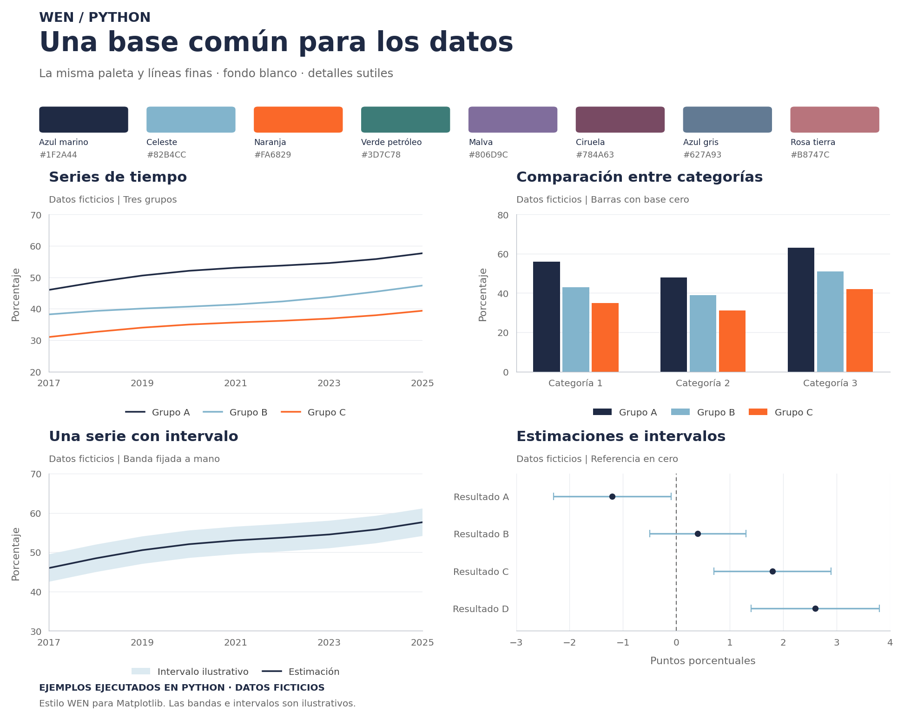

# WEN · Python

La misma lógica que Stata: códigos separados por tema en **`1_Code`**, y datos
y resultados en una carpeta compartida externa.

Los recursos comunes están en **`0_Recursos`**: `Template`, `Ejemplos` y
`README_tema.md`. **`1_Code` contiene las carpetas de los estudios**, separadas
por tema.

## Preparar el entorno una sola vez

Con Python 3.10 o superior, abre una terminal en esta carpeta y ejecuta:

```bash
python -m pip install -r requirements.txt
```

Las herramientas se instalan en ese entorno de Python. Si cambias de entorno,
instala ahí también las dependencias.

## Crear un tema

1. Crea `1_Code/nombre_del_tema`.
2. Copia los dos archivos de [`Template`](0_Recursos/Template):
   `template_wen.py` y `wen_style.py`.
3. Renombra el template, completa el encabezado y configura tu usuario y ruta.
4. Documenta el tema tomando como modelo
   [`README_tema.md`](0_Recursos/README_tema.md).

**`wen_style.py` se guarda junto al código.** Contiene todo el estilo, los
colores y las funciones para exportar. La activación `use_wen_style()` ya está
en el template; no necesitas instalar el estilo por separado.

Si tienes varios códigos, pueden llamarse `01_cargar_limpiar.py`,
`02_analisis.py` y `03_graficos.py`, todos en la misma carpeta junto a `wen_style.py`.

## Rutas de datos

El template identifica al usuario y apunta a la carpeta externa del tema:

```python
username = getpass.getuser()
workfolder = None

if username == "avaldes":
    workfolder = Path("C:/RUTA/DRIVE/WEN/nombre_del_tema")
```

Las rutas son ejemplos para editar. Para conocer tu usuario:

```python
import getpass
print(getpass.getuser())
```

La carpeta del tema debe existir. El template crea `raw`, `temp`, `data` y `out`
dentro de ella. La variable `code` apunta a la carpeta del propio script en el
repositorio, no a Drive.

| Carpeta externa | Uso |
| --- | --- |
| `raw` | Archivos originales. |
| `temp` | Archivos intermedios. |
| `data` | Bases limpias listas para analizar. |
| `out` | Gráficos, tablas y logs. |

`data` cumple la función de `dta` en Stata; los ejemplos guardan CSV. Si ambos
lenguajes comparten una sola carpeta de bases limpias, ajusta esa ruta.

## Equivalencias con Stata

| Stata | Python |
| --- | --- |
| Do-file `.do` | Código `.py`. |
| `c(username)` | `getpass.getuser()` |
| `set scheme wen` | `use_wen_style()` |
| `$wen_navy` | `wen_navy` |
| `$out/grafico.png` | `out / "grafico.png"` |

El template deja las instrucciones de carga y gráficos comentadas. Quita el
`#` y ajusta los nombres cuando quieras usarlas. El log registra los mensajes
escritos con `logging.info(...)`, no toda la consola automáticamente.

## Probar gráficos

Ejecuta [`examples_wen.py`](0_Recursos/Ejemplos/examples_wen.py) completo, o abre
una terminal en `0_Recursos/Ejemplos` y ejecuta:

```bash
python examples_wen.py
```

Genera cuatro gráficos ficticios y exporta PNG/PDF en `out`, junto al ejemplo.
También genera ahí una vista conjunta. No requiere configurar usuarios, rutas
ni bases. La carpeta `out` queda excluida del repositorio.



El código se ejecutó en Python. Los intervalos son ilustrativos. La paleta,
el ciruela y el grosor de líneas coinciden con la propuesta aprobada.

Para exportar desde un análisis:

```python
save_wen(fig, out / "evolucion_indicador.png")
save_wen(fig, out / "evolucion_indicador.pdf")
```

Las exportaciones reemplazan archivos del mismo nombre. Se admite también SVG.
