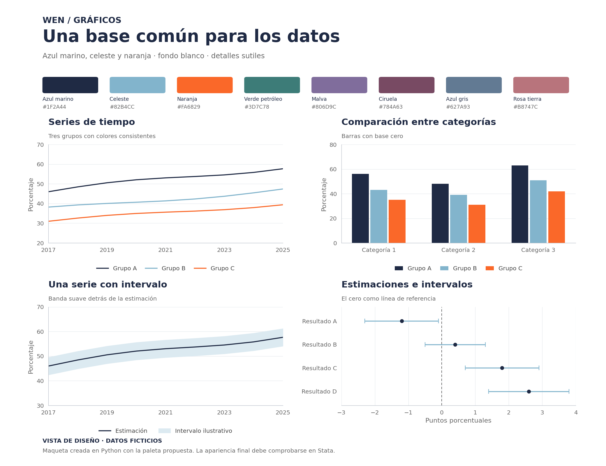

# WEN · Stata

Los códigos se guardan en **`1_Code`**, separados por tema. Los datos y resultados
van a una carpeta compartida externa a GitHub.

Los recursos comunes están en **`0_Recursos`**: `Template`, `Ejemplos` y
`README_tema.md`. **`1_Code` contiene las carpetas de los estudios**, separadas
por tema.

## Instalar el estilo una sola vez

Descarga [`wen_style.ado`](wen_style.ado) y guárdalo en la carpeta PERSONAL de
Stata. Para ver la ruta, ejecuta `sysdir`; si la carpeta no existe, créala.
Después ejecuta:

```stata
wen_style, replace
```

Si reemplazaste una versión anterior del ado, reinicia Stata antes de ejecutar
el comando. El ado instala el esquema: luego basta con `set scheme wen`, que
ya viene incluido en el template. No necesitas descargar un segundo archivo.

## Crear un tema

1. Crea `1_Code/nombre_del_tema`.
2. Copia ahí [`template_wen.do`](0_Recursos/Template/template_wen.do), ponle un
   nombre descriptivo y completa el encabezado.
3. Agrega tu usuario y la ruta de datos al bloque de Paths.
4. Documenta el tema tomando como modelo
   [`README_tema.md`](0_Recursos/README_tema.md).

El template contiene encabezado WEN, configuración inicial, rutas por usuario,
`set scheme wen`, colores como globales y secciones de carga, preparación,
análisis y gráficos. Puedes crear varios códigos con nombres como
`01_cargar_limpiar.do`, `02_analisis.do` y `03_graficos.do`.

## Rutas de datos

`workfolder` apunta a la carpeta **externa** del tema, por ejemplo una carpeta
sincronizada desde Drive. Los textos `C:/RUTA/DRIVE/...` son ejemplos para cambiar.
Para conocer tu usuario: `display c(username)`.

```stata
global workfolder ""

if "`c(username)'" == "avaldes" {
    global workfolder "C:/RUTA/DRIVE/WEN/nombre_del_tema"
}
```

El template incluye otro usuario de ejemplo y se detiene si tu usuario no
está configurado. Una vez definida la ruta, crea `raw`, `temp`, `dta` y `out`.
El do-file se queda en el repositorio; no se crea otra carpeta de códigos en Drive.

| Carpeta externa | Uso |
| --- | --- |
| `raw` | Archivos originales, tal como se reciben o descargan. |
| `temp` | Bases y archivos intermedios. |
| `dta` | Bases limpias en formato Stata. |
| `out` | Gráficos, tablas y logs. |

Cada código usa un nombre de log distinto. Las instrucciones de carga, guardado
y gráficos del template están comentadas: activa las que necesites y cambia
los nombres de variables y archivos.

## Probar gráficos

Después de instalar el estilo, abre
[`examples_wen.do`](0_Recursos/Ejemplos/examples_wen.do) y ejecútalo completo.
No requiere editar rutas ni cargar bases: genera datos ficticios y conserva los
datos abiertos con `preserve`/`restore`. Dibuja series, barras, una banda y
estimaciones con intervalos. Las exportaciones del final son opcionales.



La imagen es una maqueta creada en Python; la ejecución y apariencia final
deben comprobarse en Stata. El estilo conserva líneas finas y ciruela.
